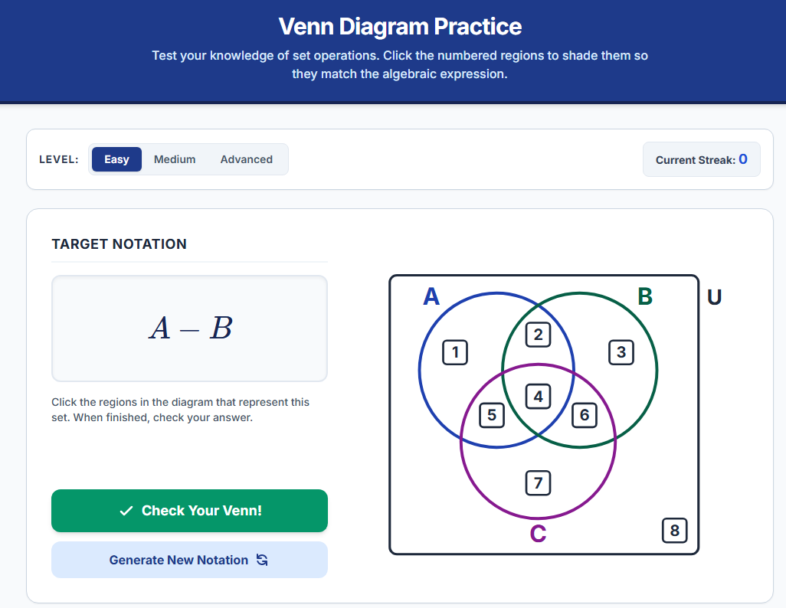

# Interactive Venn Diagram Practice

An interactive, web-based educational tool designed to help students master set theory and algebra of sets. By dynamically shading regions of a 3-set Venn diagram, students can test their knowledge of unions, intersections, complements, and set differences.



## 🌟 Features

*   **Interactive SVG Diagram:** A mathematically precise, responsive Venn diagram (Sets A, B, and C) where students can click to toggle any of the 8 canonical regions.
*   **Three Difficulty Levels:**
    *   **Easy:** Fundamental operations ($A \cup B$, $A \cap B$, $A^c$, $A - B$).
    *   **Medium:** Compound operations mixing two concepts ($(A \cup B)^c$, $A \cap (B \cup C)$).
    *   **Advanced:** Complex, mathematically interesting expressions ($(B \cup C) \cap A^c$).
*   **Intelligent Feedback Engine:** Instead of just revealing the correct answer, the tool evaluates the student's submission and determines exactly which regions were missed or erroneously included.
*   **Growth Mindset Pedagogy:** Built-in positive affirmations encourage *productive struggle*. If a student makes a mistake, the tool provides the formal set-builder definitions of the operations in play and gentle hints (e.g., "Check Region 4 again") to guide them toward the answer.
*   **Gamification:** A streak counter tracks consecutive correct answers to motivate students.
*   **High-Quality Math Typesetting:** Integrated with MathJax for crisp, LaTeX-style rendering of set notations.
*   **Accessible Design:** WCAG-friendly color palette, focus rings, and high-contrast visuals using Tailwind CSS.

## 🧠 Pedagogical Approach

This tool is designed with a **growth mindset** framework. When a student submits an incorrect configuration:
1.  They receive a positive affirmation encouraging perseverance.
2.  The engine dynamically looks at the active question (e.g., $(A \cup B)^c$) and provides the formal mathematical definitions for the specific operations involved (Union and Complement).
3.  The engine provides non-prescriptive hints (e.g., hinting at a specific missed region) rather than solving the problem for them. 
4.  This keeps the student in a state of *productive struggle*, forcing them to apply the definitions to the visual model.

## 🛠 Technologies Used

*   **HTML5 / SVG:** For the structural layout and complex masking/geometry required to perfectly shade overlapping circular regions.
*   **Vanilla JavaScript:** Handles application state, mathematical boolean evaluations, and dynamic DOM updates.
*   **Tailwind CSS:** Utilized via CDN for rapid, modern, responsive styling.
*   **MathJax 3:** Renders high-quality mathematical notation dynamically.

## 🚀 Getting Started

Because this application relies entirely on client-side technologies without any build steps or dependencies, getting started is incredibly easy.

1.  **Clone the repository:**
    ```bash
    git clone https://github.com/yourusername/venn-diagram-practice.git
    ```
2.  **Open the file:**
    Navigate to the project directory and open `index.html` in any modern web browser (Chrome, Firefox, Safari, Edge).
    ```bash
    cd venn-diagram-practice
    open index.html # On macOS
    # or just double-click the file in your file explorer
    ```

## 📖 How to Use

1.  Select a difficulty level (Easy, Medium, or Advanced).
2.  Look at the generated **Target Notation** (e.g., $(A \cup B) - C$).
3.  Click the numbered boxes inside the Venn diagram to shade the corresponding regions.
4.  Once you believe your shaded diagram perfectly represents the notation, click **Check Your Venn!**.
5.  Read the feedback provided. If incorrect, use the hints and definitions to adjust your shading and try again!
6.  Click **Generate New Notation** to try a new problem.

## 🤝 Contributing

Contributions, issues, and feature requests are welcome! 
Feel free to check [issues page](https://github.com/yourusername/venn-diagram-practice/issues) if you want to contribute. Some ideas for future development:
*   Adding 2-set and 4-set diagram modes.
*   Adding a mode where the *diagram* is shaded and the user must type the *notation*.
*   Saving streaks via `localStorage`.

## 📝 License

This project is [MIT](https://opensource.org/licenses/MIT) licensed.
